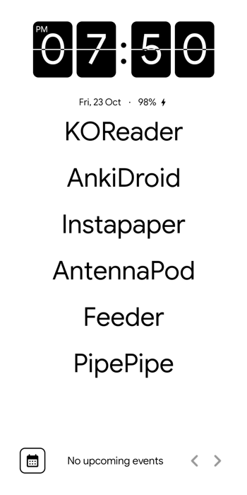
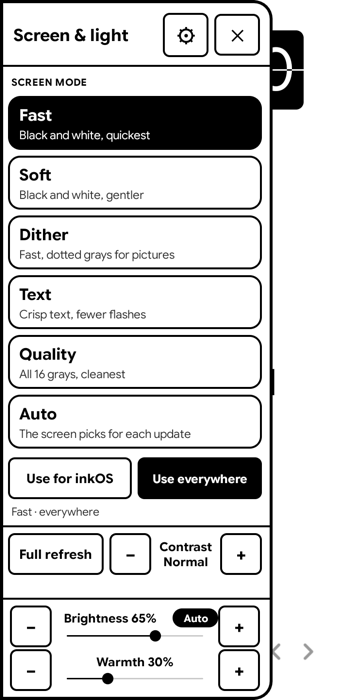

# KompaktOS on the Moaan InkPalm Plus

Scripts, notes and a small root helper for running **KompaktOS 1.2** (LineageOS 23.2, Android 16, as a
GSI) on the **Moaan InkPalm Plus** e-ink phone (Rockchip rk3566, 720x1440 panel, stock Android 11,
kernel 4.19).

This is a hobby port made on one device. It works as a daily driver for its author, with the limits
listed below. **You can brick your phone. Read [Risks](#risks-and-no-warranty) first.**

Not affiliated with Moaan or Mudita. Nothing here is endorsed by them, by KompaktOS or by LineageOS.

<!-- TODO(photos): replace with a real photo of the InkPalm Plus running KompaktOS, taken with a camera.
     Save as docs/images/device-front.jpg and uncomment.

-->
> **Photo placeholder:** `docs/images/device-front.jpg` (the phone running KompaktOS, in hand or on a table).

  
  

Left: the KompaktOS launcher on the InkPalm Plus. Right: the e-ink and front light panel from
[InkPalm+](https://github.com/rn-os/inkpalm-plus), opened from the screen edge.

<!-- TODO(photos): more camera photos, each saved in docs/images/:
     device-sleep-screen.jpg   the sleep (standby) picture on the powered-down panel
     device-poweroff.jpg       the power-off picture
     device-side.jpg           the phone from the side / next to the stock firmware, optional
     Settings > About screenshot on KompaktOS: docs/images/about.png -->
> **More photo placeholders:** `docs/images/device-sleep-screen.jpg`, `docs/images/device-poweroff.jpg`,
> `docs/images/about.png` (Settings, About, on KompaktOS).

## What this is

KompaktOS is a LineageOS-based ROM built for the Mudita Kompakt. This repo does **not** contain it. It
contains what is needed to get the KompaktOS GSI (generic system image) to run on the InkPalm Plus's
stock Android 11 vendor, which was never made for it:

- **Display fix** (`gsi/vendor-fix/`): Moaan's e-ink HWC library needs the stock Android 11 `libskia`
  and a few more libraries that a GSI does not ship. They are overlaid on `/vendor/lib64` at boot, with
  a stub `libheif` (`heif_stub.c`). Without this the display stack crash-loops.
- **Touch fix**: an input-device map (`fts_ts.idc`) for the rotated FocalTech panel.
- **Root bridge** (`eink-bridge.sh`, `eink-apply.sh`): lets the InkPalm+ app set the e-ink mode, request a
  full refresh, drive the warm and cold front light, set the sleep and power-off pictures, and power
  the phone off after N hours asleep. Whitelisted requests only.
- **Defaults** (`inkpalm-defaults.sh`): a few stock behaviours KompaktOS lacks (battery percent,
  animations off, gesture navigation, density 312, and so on), applied once on first boot.
- **Image tools** (`tools/`): partition backup, building a custom `super` image, boot animation
  rescaling, a diagnostics script.
- **`build-layer/`**: an unfinished scaffold for building KompaktOS from source with these fixes inside.
  Never run. Treat it as notes.
- **`gsi/einkservice/`**: an early design for a system e-ink service. Superseded by the bridge and InkPalm+.

The companion app is **[InkPalm+](https://github.com/rn-os/inkpalm-plus)**: its *Screen & light* panel
is the user interface for e-ink modes and the front light on KompaktOS. It replaces `tools/inkcontrol`
in this repo, which is retired and kept only as history.

## What works, and what doesn't

Tested by the author on one InkPalm Plus (stock build `MAS_EPD305_L81B804_T44_V09`), KompaktOS 1.2 Global
Vanilla, slot B. A diagnostics run on the flashed image passed 25 checks.

Works:
- Boot, display (Moaan's own e-ink HWC), touch, gesture navigation, SELinux enforcing
- E-ink modes (Fast, Soft, Dither, Text, Quality, Auto), full refresh on demand, ghost clearing
  (a full refresh every 40 partial ones)
- Front light, cold and warm, off at screen-off and restored at screen-on
- Sleep picture, power-off picture, auto power-off (see the notes; the real-shutdown picture still needs a test)
- Capacitive button as Home
- Wi-Fi, microG (installed as user apps; KompaktOS's framework accepts the official microG signature)
- Data from the stock system restored from your own backup (apps and files)

Known limits and open items:
- **Not tested yet:** auto power-off end to end, the power-menu shutdown picture, front light after a long
  unplugged sleep, microG self-check.
- **Widevine is L3 only** (no `liboemcrypto`), normal for a GSI.
- **Edge Back gesture:** KompaktOS builds without a navigation bar, so Android's own back gesture never
  attaches. InkPalm+ does Back from an edge swipe instead.
- **E-ink presets are partly cosmetic.** The vendor HWC may re-pick the mode by screen content depending on
  `persist.sys.mogu.refresh_type` (see `docs/HANDOFF.md`). A new mode only applies to pixels drawn after it.
- **Perfetto `traced` crash-loops at boot** (the vendor build.prop sets a vsock port, the 4.19 kernel has no
  vsock). Harmless, tracing only.
- **Not restored from stock:** the stock font and UI gamma setting, and Moaan's own launcher features.
- KompaktOS's own e-ink Quick Settings tiles and warmth slider do not drive this panel.
- Slot A is left empty; there is no second system to fall back to except by restoring your backup.
- One device, one stock build. Other InkPalm builds are untested.
- Android 16 on a 4.19 kernel is not something Google supports. Expect rough edges.

## What you need to bring

This repo ships no Moaan, Rockchip, Google or KompaktOS binaries, on purpose. You supply:

1. **An InkPalm Plus with an unlocked bootloader**, and a USB-C cable (direct, not a hub).
   Unlocking wipes the phone; how to do it is up to you and Moaan's instructions. TODO(maintainer): link a source.
2. **A full backup of your stock firmware, made from your own device.** Use `tools/backup_stock_partitions.sh`
   (needs a booted test GSI with `adb root`, because Moaan's loader blocks reads past 32 MiB) and
   `tools/backup_super_chunked.sh`. You need at least `super`, `boot_b`, `vbmeta_b` and `dtbo_b`, with checksums.
   `tools/mtpdump.c` copies `/sdcard/Android/data` over MTP. **Without this backup you cannot go back.**
3. **The stock Android 11 libraries the display needs**, taken from your own backup's system and ART apex:
   `libskia.so`, `libdng_sdk.so`, `libft2.so`, `libandroidicu.so`, `libicuuc.so`, `libicui18n.so`.
   `build-layer/extract-blobs.sh` pulls them out of your `super.img` backup. They are Moaan/Google code and are
   not redistributed here. The stub `libheif.so` is built from `gsi/vendor-fix/heif_stub.c` (clang, see `gsi/vendor-fix/README.md`).
4. **The KompaktOS 1.2 Global Vanilla system image**, from its own source ([KompaktOS](https://github.com/gezimos/KompaktOS),
   which builds on MisterZtr's LineageOS GSI, see Credits). Use the EXT4 variant (EROFS needs kernel 5.4).
   TODO(maintainer): state the exact release page and file name you used.
5. **A Mac or Linux computer** with `adb` and `fastboot` (platform-tools), Python 3, clang and `lld` for the stub,
   and e2fsprogs (`e2fsck`, `resize2fs`, `debugfs`; `bake.sh` expects Homebrew's path on macOS and may need a path change on Linux).
   `build_super.py` is plain Python (no `lpmake` needed).
6. **The InkPalm+ app** from its [releases](https://github.com/rn-os/inkpalm-plus/releases), for the e-ink and light controls.
7. Optional: your own PNGs for the sleep and power-off screens. Moaan's pictures are not included.

## Build and flash, step by step

1. Back up everything (item 2 above). Check the checksums.
2. Prepare the libraries (item 3) in one folder, plus `gsi/vendor-fix/fts_ts.idc`.
3. Bake the fixes into the system image:
   `gsi/vendor-fix/bake.sh <kompaktos-system.img> <baked.img> <libdir> gsi/vendor-fix/fts_ts.idc`
   (set `GROW_MB=0` if the image must keep its size, and `BOOTANIM=` for a rescaled boot animation; see the script header).
4. Build a `super` image from your own stock super backup: `tools/build_super.py <stock_super.img> <baked.img> <out_super.img>`.
5. Flash it as described in **[docs/FLASH-KOMPAKTOS.md](docs/FLASH-KOMPAKTOS.md)**. This **erases `super`, `userdata` and `metadata`**.
6. First boot takes several minutes with no feedback on e-ink. Install InkPalm+, grant its permissions, enable its accessibility service.
7. To go back to stock: **[docs/REVERT.md](docs/REVERT.md)** (flash your stock `super` backup, wipe, reboot).

Other docs: [docs/gsi-scoping.md](docs/gsi-scoping.md) (research on GSIs for this device, some of it
unverified and marked so), [docs/sleep-screen.md](docs/sleep-screen.md) (how the sleep picture is drawn),
[docs/HANDOFF.md](docs/HANDOFF.md) (the maintainer's working log), [tools/diag/CHECKS.md](tools/diag/CHECKS.md)
(diagnostics), [gsi/vendor-fix/README.md](gsi/vendor-fix/README.md) (the display fix in detail).

## Risks and no warranty

Flashing replaces your phone's system and erases your data. A wrong step, a bad cable or a power loss
can leave the device unbootable. This was done on one device by one person, and the docs are the author's
notes, not a tested installer. Everything is provided as is, **with no warranty of any kind**. You do this at
your own risk. Flashing may void your warranty and may break features that depend on Moaan's software.
Keep your backup somewhere safe, and test restoring it before you rely on the phone.

## Credits

- **[KompaktOS](https://github.com/gezimos/KompaktOS)** and **[KompaktDevice](https://github.com/gezimos/KompaktDevice)** by gezimos:
  the ROM and its patch series this port is based on, made for the Mudita Kompakt. The e-ink feature set
  mirrored here (presets, refresh, front light) comes from its design.
- **[LineageOS](https://github.com/LineageOS/android)**: the base of KompaktOS (23.2, Android 16).
- **[MisterZtr/LineageOS_gsi](https://github.com/MisterZtr/LineageOS_gsi)**: the LineageOS GSI builds that KompaktOS is
  based on, with Android 11 vendor support.
- **[TrebleDroid / phhusson's treble_experimentations](https://github.com/TrebleDroid/treble_experimentations)**: Project Treble GSI work,
  including `phhsu_daemon` and the root daemon the bridge runs under.
- **[AndyYan's LineageOS GSIs](https://sourceforge.net/projects/andyyan-gsi/)**: the Android 14 GSI used for the first DSU boots.
- **Rockchip**: the rk3566 SoC and the e-ink (EBC) driver stack the vendor image builds on.
- **Moaan**: maker of the InkPalm Plus. Its stock firmware and libraries are theirs; none are included here.
- **[InkPalm+](https://github.com/rn-os/inkpalm-plus)**: the companion app (and where InkControl's features went).
- The InkPalm Plus hardware overview: [CNX Software](https://www.cnx-software.com/2022/05/25/150-inkpalm-plus-ereader-features-rk3566-soc-5-84-inch-display/).
- TODO(maintainer): microG, Shizuku or others you want to thank; none of these were confirmed in the docs as dependencies of this repo.

Not affiliated with Moaan or Mudita.

## License

TODO(maintainer): no license has been chosen yet. Until one is added, all rights are reserved.
Note that `gsi/vendor-fix`, `tools/` and the docs are original work; the stock libraries and the KompaktOS
image are not part of this repo and keep their own licenses.
